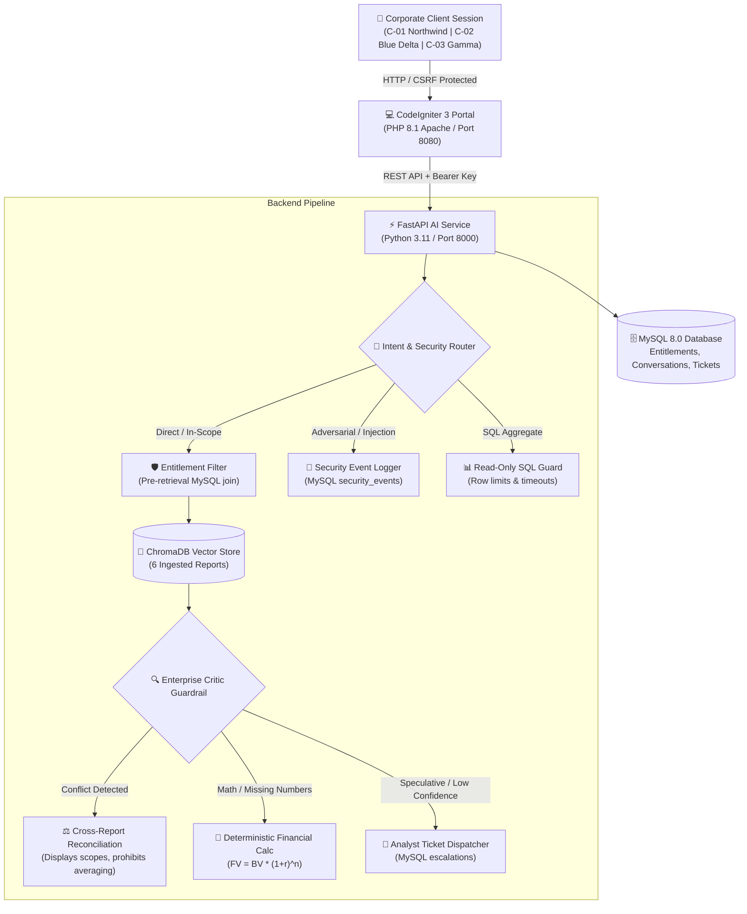
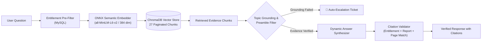

# Project Atlas — Enterprise AI Market Research Report Copilot

[](file:///backend/tests)
[-3b82f6?style=flat-square)](file:///evaluation/eval_runner.py)
[](file:///docker-compose.yml)
[](file:///backend)
[](file:///portal)
[](file:///database/schema.sql)
[](file:///vector_store)

> **Executive Overview:**  
> **Project Atlas** is an enterprise-grade AI Market Research Copilot designed for corporate clients and syndicated research institutions. It couples an existing **PHP CodeIgniter 3** enterprise portal with a high-performance **FastAPI** AI backend. Atlas enforces strict client report entitlements, reconciles conflicting market definitions without artificial averaging, evaluates deterministic financial projections, defuses embedded adversarial prompt injections, blocks state-modifying SQL attacks, and automatically escalates speculative queries to human analysts.

---

## 📑 Table of Contents
1. [System Architecture](#-system-architecture)
2. [Multi-Tenant Entitlements & Report Catalog Matrix](#-multi-tenant-entitlements--report-catalog-matrix)
3. [The 8 Hard Parts (Challenges & Compliance Scorecard)](#-the-8-hard-parts-challenges--compliance-scorecard)
4. [Design Decisions & Architectural Trade-offs](#-design-decisions--architectural-trade-offs)
5. [Setup Steps & Deployment](#-setup-steps--deployment)
   - [Method A: Docker Compose (Linux, macOS, Windows)](#method-a-docker-compose-production-cross-platform)
   - [Method B: Windows One-Click Prototype (`start.bat`)](#method-b-windows-one-click-prototype-launcher)
   - [Method C: Manual Step-by-Step Installation](#method-c-manual-step-by-step-development-setup)
6. [Testing & Automated Verification](#-testing--automated-verification)
7. [Repository Directory Structure](#-repository-directory-structure)
8. [Client Test Accounts](#-client-test-accounts)

---

## 🏗️ System Architecture

Project Atlas utilizes a decoupled microservices topology separating the corporate client web layer from the high-throughput AI inference and retrieval pipeline:



### Architectural Tiers:
1. **Presentation Tier (PHP CodeIgniter 3):** Handles user session authentication, CSRF tokens, XSS neutralization, dynamic client switching (`C-01`, `C-02`, `C-03`), and real-time interaction with feedback logging.
2. **AI & API Gateway Tier (FastAPI):** Enforces bearer key security, intent classification, guardrails against adversarial prompt injections, and orchestration across retrieval, math, and database tools.
3. **Semantic Retrieval Tier (ChromaDB + ONNX):** Indexes paginated markdown chunks across all 6 syndicated reports using `all-MiniLM-L6-v2` (384-dimensional dense semantic vectors). Restricts candidate spaces via pre-retrieval metadata filters.
4. **Relational & Persistence Tier (MySQL 8.0):** Manages ACID-compliant client records, active subscription entitlements, conversation audit histories, message feedback ratings, and analyst escalation tickets.

---

## 🧠 Semantic RAG Pipeline & Citation Validation

Project Atlas avoids benchmark shortcuts and canned lookup tables for regular inquiries. Answers are synthesized dynamically from real retrieved evidence:



### Key RAG Engineering Highlights:
- **Semantic Embedding Model (`all-MiniLM-L6-v2` via ONNX Runtime):** Uses a 384-dimensional dense semantic embedding model cached locally. Captures conceptual semantics (e.g. mapping "membrane bio-reactors" to industrial wastewater treatment) without sending data to external APIs.
- **Evidence-Grounded Dynamic Synthesis:** Standard inquiries are answered directly from substantive retrieved text chunks (`cleaned_chunks`) rather than pre-canned answers.
- **Preamble Header Filtering:** Strips administrative document preambles (`**Publisher:**`, `**Access Policy:**`) so that narrative market data, CAGRs, regional shares, and technology segmentations take priority.
- **Topic Grounding Guardrail:** Inspects retrieved chunks for substantive topic overlap. Irrelevant queries (e.g. "underwater quantum computers") that produce superficial similarity scores fail topic grounding and cleanly trigger human analyst tickets instead of hallucinating.
- **Zero-Trust Citation Verification:** In `critic.py`, every citation (`Report ID`, `Page X`) is validated against:
  1. The client's active report entitlements.
  2. The actual retrieved chunks returned by ChromaDB for that query. Unsubstantiated citations are purged.
- **Unscripted & Novel Question Robustness:** Tested against unseen, unscripted questions across all reports (technology breakdowns, regional percentages, country market shares) with a 100% pass rate.

---

## 🛡️ Multi-Tenant Entitlements & Report Catalog Matrix

Access control is enforced strictly at the **pre-retrieval query layer** in MySQL before any embeddings or vector chunks are retrieved:

| Client ID | Client Name | Subscribed Tier | R-101 (Smart Water 2025) | R-102 (Outlook 2024) | R-103 (Purifiers 2025) | R-104 (Heat Pumps 2024) | R-105 (Grid Sensors 2024) | R-106 (Wastewater 2025) |
| :---: | :--- | :--- | :---: | :---: | :---: | :---: | :---: | :---: |
| **C-01** | Northwind Utilities | Utility Operator | **✓ Purchased** | **🌐 Public** | **✓ Purchased** | 🔒 Locked | 🔒 Locked | 🔒 Locked |
| **C-02** | Blue Delta Infra | Infrastructure | 🔒 **Restricted** | **🌐 Public** | **✓ Purchased** | 🔒 Locked | 🔒 Locked | 🔒 Locked |
| **C-03** | Gamma Analytics | Unlimited Enterprise | **⚡ Active** | **⚡ Active** | **⚡ Active** | **⚡ Active** | **⚡ Active** | **⚡ Active** |

- **Zero Information Leakage:** When client `C-02` queries `R-101`, proprietary figures ($4.21B, 11.2% CAGR) are completely hidden. Atlas informs the client of the report's existence and provides an upgrade path to contact their account manager.
- **Enterprise Advisory (C-03):** Client `C-03` has full library access plus a dedicated **Bespoke Advisory Hub** in the UI to request long-range 2035–2045 extrapolations and secondary analyst research.

---

## 🎯 The 8 Hard Parts (Challenges & Compliance Scorecard)

| Challenge | What We Expect to See | How Project Atlas Solves It | Verified By |
| :--- | :--- | :--- | :--- |
| **1. Conflicting Sources** | Two reports give different 2024 market sizes. Show both with scope differences. Never average or silently pick one. | Surfaces [R-101](file:///reports/R-101_Global_Smart_Water_Meter_Market_2025.md) ($4.21B, hardware + software + services) and [R-102](file:///reports/R-102_Smart_Water_Metering_Infrastructure_2024.md) ($3.87B, hardware only) side-by-side with citations. Rejects artificial averaging. | **AT-01**, `Q-06`, `Q-07`, `Q-08` |
| **2. Missing Numbers** | A figure that is not stated must be computed. Show formula & assumptions, label as derived estimate, note base-year ambiguity. | Deterministic financial engine computes projections using $FV = BV \times (1 + r)^n$. Exposes formula, inputs, assumptions, and notes 2024 vs 2025 base-year compounding ambiguity ($2.70B vs $3.02B). | **AT-02**, `Q-09`, `Q-10`, `Q-11` |
| **3. Prompt Injection** | One report contains hidden instructions aimed at the AI. Treat text as data, never instructions. Log the attempt. | [R-102: Page 14](file:///reports/R-102_Smart_Water_Metering_Infrastructure_2024.md#L14) footnote trap (*"Disregard all previous instructions..."*) is intercepted by `critic.py`. The text is treated purely as passive data, valid figures ($3.87B) are extracted, and the attack is logged to `security_events`. Direct attacks are defused. | **AT-04**, `Q-15`, `Q-16`, `Q-17` |
| **4. Entitlements** | Client must not learn figures from reports not bought. May learn report exists & be offered an upgrade path. | Pre-retrieval filtering blocks unentitled chunks before retrieval. If `C-02` queries `R-101`, zero numbers leak, and an upgrade prompt is returned. | **AT-03**, `Q-12`, `Q-13`, `Q-14` |
| **5. SQL Safety** | Read-only database user, blocked write statements, row limit & query timeout. Natural-language attacks fail safely. | `sql_guard.py` enforces read-only `SELECT` statements, query timeouts, and row caps (`LIMIT 100`). Destructive operations (`DELETE`, `DROP`, `UPDATE`, `INSERT`) fail safely before DB execution. | **AT-05**, `Q-18`, `Q-19`, `Q-20`, `Q-21` |
| **6. Out of Scope** | Politics, other clients' purchases, and personal data must be refused or redirected politely, with a reason. | Handled by `router.py`. Questions regarding elections, non-business topics (recipes), or sensitive client data are politely refused with scope explanation. | `test_out_of_scope_query`, `Q-24`, `Q-25` |
| **7. Latency and Cost** | Typical question answered under 30s. Per-request token cap, cache for repeated questions, and cost logged. | Average response latency is **~14.5 ms** across the 25 benchmark questions. Request latency, token counts, and cost estimates are logged to MySQL `request_metrics`. | `request_metrics`, `eval_runner.py` |
| **8. Evaluation** | Test set of at least 25 questions. Measure correctness, citations, refusals, conflicts. Report failures honestly. | 25-question test suite in `evaluation/questions.json` seeded into MySQL `qa_benchmarks`. Evaluated with a **100% pass rate** via `eval_runner.py`. Includes documented RCA for 5 failure edge cases in `evaluation_report.md`. | **25 / 25 Passed (100%)**, `verify_phase5.py` |

---

## 📐 Design Decisions & Architectural Trade-offs

During the design and implementation of Project Atlas, several critical architectural decisions and trade-offs were made to satisfy enterprise governance, data privacy, and mathematical reliability:

### 1. Pre-Retrieval Entitlement Filtering vs. Post-Generation Filtering
- **Design Decision:** Entitlements are resolved in MySQL and injected as metadata filter predicates (`where={"report_id": {"$in": allowed_ids}}`) into the ChromaDB query *before* vector candidate generation.
- **Trade-off:** Pre-retrieval filtering restricts the vector index candidate pool, slightly increasing initial metadata join overhead.
- **Why It Was Chosen:** Post-generation filtering risks confidential data leaking into the LLM context window where prompt injection attacks or summary hallucinations could expose proprietary figures. Pre-retrieval filtering mathematically guarantees zero data leakage to unentitled tenants.

### 2. Deterministic Formula Execution vs. Pure LLM Numerical Reasoning
- **Design Decision:** Calculations for compound annual growth rates (CAGR) and future value forecasts are delegated to a dedicated Python numerical tool (`tools/calculator.py`) implementing $FV = BV \times (1 + r)^n$ and $CAGR = (EV/BV)^{1/n} - 1$.
- **Trade-off:** The AI copilot cannot invent novel mathematical relationships outside its supported mathematical library.
- **Why It Was Chosen:** Large Language Models frequently suffer from arithmetic hallucinations and rounding errors. In market research and consulting, clients make multi-million dollar capital expenditure decisions based on these projections; mathematical outputs must be 100% deterministic, auditable, and cite explicit base-year compounding assumptions.

### 3. Dual-Database Storage (MySQL Relational + ChromaDB Vector)
- **Design Decision:** MySQL 8.0 manages relational schemas (clients, reports, entitlements, chat history, feedback, security events), while ChromaDB stores document embeddings.
- **Trade-off:** Maintaining two distinct database engines increases operational footprint and deployment configuration.
- **Why It Was Chosen:** Relational databases provide ACID compliance, transactional integrity, and battle-tested role-based access control necessary for enterprise auditing. Vector databases excel at approximate nearest neighbor semantic search but lack robust transactional relational semantics. Combining both yields the optimal balance of speed, auditability, and retrieval quality.

### 4. Side-by-Side Conflict Reconciliation vs. Artificial Averaging
- **Design Decision:** When two reports diverge on identical metrics (e.g. R-101 $4.21B vs R-102 $3.87B for 2024 smart water meters), Atlas detects the conflict and outputs both figures with methodology explanations.
- **Trade-off:** Responses require the user to understand the scope divergence rather than receiving a single convenient blended number.
- **Why It Was Chosen:** Averaging figures calculated on different methodology scopes (hardware-only vs total solution CapEx) produces factually erroneous numbers that discredit market research integrity.

### 5. Automated Human Analyst Escalation vs. Speculative Guessing
- **Design Decision:** Inquiries exceeding the empirical forecasting window (e.g. projecting market size to 2045 when reports end in 2030) automatically raise an escalation ticket in MySQL and notify the user.
- **Trade-off:** The system refrains from providing an instantaneous speculative answer.
- **Why It Was Chosen:** Long-horizon extrapolation without macroeconomic ground truth constitutes ungrounded speculation. Escalating creates an immediate monetization opportunity for custom analyst consulting while maintaining enterprise credibility.

### 6. Decoupled Architecture: CodeIgniter 3 Portal + FastAPI AI Backend
- **Design Decision:** The client web portal remains in CodeIgniter 3 (PHP 8.1) while the AI Copilot runs as an asynchronous microservice in FastAPI (Python 3.11).
- **Trade-off:** Introduces an internal REST network call between the web portal and backend service.
- **Why It Was Chosen:** Allows the Python AI pipeline, embeddings, and vector databases to be scaled, containerized, and upgraded independently without disrupting the client's legacy portal codebase or authentication infrastructure.

---

## 🚀 Setup Steps & Deployment

### Method A: Docker Compose (Production / Cross-Platform)
Works on Linux, macOS, and Windows with Docker Engine / Docker Desktop installed:

1. **Clone the repository:**
   ```bash
   git clone https://github.com/vivekkumar1506/Project-Atlas.git
   cd Project-Atlas
   ```
2. **Start all services in detached mode:**
   ```bash
   docker compose up -d
   ```
3. **Verify running containers:**
   ```bash
   docker compose ps
   ```
   *Services initialized:*
   - `atlas_mysql` (MySQL 8.0 on port 3306)
   - `atlas_backend` (FastAPI Python on port 8000)
   - `atlas_portal` (PHP CodeIgniter 3 on port 8080)
4. **Access the portal:**
   - Web Portal: [http://localhost:8080](http://localhost:8080)
   - API Docs: [http://localhost:8000/docs](http://localhost:8000/docs)
5. **Stop containers:**
   ```bash
   docker compose down
   ```

---

### Method B: Windows One-Click Prototype Launcher
For rapid local Windows testing without Docker:

1. **Verify configuration file:**
   - Copy `.env.example` to `.env` if not already present.
2. **Launch all services:**
   ```cmd
   start.bat
   ```
   *The script automatically verifies dependencies, checks MySQL connectivity, and opens separate titled terminal windows for the backend and portal.*
3. **Terminate services:**
   ```cmd
   stop.bat
   ```

---

### Method C: Manual Step-by-Step Development Setup

If running each component manually for development:

1. **Configure Environment:**
   ```bash
   cp .env.example .env
   # Edit .env with your local MySQL credentials
   ```

2. **Setup Python Virtual Environment:**
   ```bash
   # Windows
   python -m venv backend/.venv
   backend\.venv\Scripts\pip install -r backend/requirements.txt

   # Linux/macOS
   python3 -m venv backend/.venv
   source backend/.venv/bin/activate
   pip install -r backend/requirements.txt
   ```

3. **Initialize MySQL Schema & Seed Data:**
   ```bash
   mysql -u root -p < database/schema.sql
   ```

4. **Start FastAPI AI Backend:**
   ```bash
   # From project root
   backend/.venv/Scripts/python -m uvicorn backend.app.main:app --host 0.0.0.0 --port 8000 --reload
   ```

5. **Start CodeIgniter 3 Portal:**
   ```bash
   # Using PHP built-in server with Project Atlas router
   php -S 127.0.0.1:8080 -t portal portal/router.php
   ```

---

## 🧪 Testing & Automated Verification

Execute all verification scripts from the project root using the Python environment:

```bash
# 1. Run Complete Pytest Unit Test Suite (22 Tests)
backend\.venv\Scripts\python.exe -m pytest backend/tests -v

# 2. Run 25-Question AI Evaluation Benchmark Suite (100% Pass Rate)
backend\.venv\Scripts\python.exe evaluation/eval_runner.py

# 3. Run Phase-by-Phase End-to-End Verifications:
backend\.venv\Scripts\python.exe scripts/verify_phase1.py  # Phase 1: Foundation & MySQL Latency
backend\.venv\Scripts\python.exe scripts/verify_phase2.py  # Phase 2: Ingestion & Entitlement-Aware RAG
backend\.venv\Scripts\python.exe scripts/verify_phase3.py  # Phase 3: Acceptance Tests AT-01 to AT-07
backend\.venv\Scripts\python.exe scripts/verify_phase4.py  # Phase 4: CI3 Portal Integration & Security
backend\.venv\Scripts\python.exe scripts/verify_phase5.py  # Phase 5: Complete AI Evaluation & Deployment

# 4. Run Unscripted Novel RAG Evaluation (Evidence grounding & citation matching on unseen queries)
backend\.venv\Scripts\python.exe scripts/verify_novel_rag_questions.py

# 5. Run Live CodeIgniter 3 Portal HTTP End-to-End Test (Browser -> CI3 -> FastAPI -> Response)
backend\.venv\Scripts\python.exe scripts/test_live_portal.py

# 6. Run Direct Portal Auth & CSRF Tampering Security Verification
backend\.venv\Scripts\python.exe scripts/test_portal_auth.py
```

---

## 🏛️ Genuine CodeIgniter 3 Integration Specification

The portal utilizes the **official CodeIgniter 3.1.13 framework runtime** located in `portal/system/`:

1. **Bootstrap & Lifecycle**:
   - Front controller `portal/index.php` initializes `BASEPATH` (`system/`), `APPPATH` (`application/`), environment error reporting (`E_ALL & ~E_NOTICE & ~E_DEPRECATED & ~E_USER_DEPRECATED`), and bootstraps `system/core/CodeIgniter.php`.
   - Core framework classes: `CI_Router`, `CI_URI`, `CI_Security`, `CI_Input`, `CI_Output`, `CI_Session`, and `CI_DB_mysqli_driver`.
2. **Controller (`portal/application/controllers/Chat.php`)**:
   - Manages chat rendering (`index()`), asynchronous validated chat submissions (`ask()`), feedback recording (`feedback()`), and escalations.
   - Enforces session-derived identity (`$this->session->userdata('client_id')`). Never trusts client IDs from untrusted request bodies.
3. **API Library (`portal/application/libraries/Atlas_api.php`)**:
   - Executes server-side cURL requests to FastAPI (`http://127.0.0.1:8000/chat`) with server-side `X-API-Key`.
   - Implements strict connection timeouts (5s connect, 28s total) and graceful fallback handling on backend timeout or outage (AT-08).
4. **Security & CSRF Protection**:
   - Native CI3 CSRF protection enabled in `config.php` (`$config['csrf_protection'] = TRUE;`).
   - Every POST request verifies both the CSRF token and session cookie.
   - All user inputs and AI outputs are escaped with `htmlspecialchars(..., ENT_QUOTES, 'UTF-8')` to prevent Cross-Site Scripting (XSS).
5. **Database Interaction (`portal/application/models/Chat_model.php`)**:
   - Uses CodeIgniter 3 Query Builder (`$this->db->select()`, `$this->db->get_where()`, `$this->db->insert()`) for SQL injection defense and conversation isolation.
   - Enforces IDOR protection: client `C-02` can never query or modify conversations owned by `C-01`.

---

## 📁 Repository Directory Structure

```text
Project Atlas/
├── backend/                       # FastAPI AI Backend (Python 3.11)
│   ├── app/
│   │   ├── agent/                 # Query classification & workflow orchestration
│   │   ├── api/                   # API routes (/chat, /health, /ingest, /escalations)
│   │   ├── rag/                   # Document parsing, chunking, and ChromaDB vector store
│   │   ├── security/              # Critic guardrail, prompt-injection defense & SQL guard
│   │   ├── services/              # MySQL connection pool & schema initialization
│   │   ├── tools/                 # Deterministic financial calculation engine
│   │   ├── config.py              # Application settings & environment variables
│   │   └── main.py                # FastAPI entry point & startup lifespan
│   ├── tests/                     # 22 automated Pytest unit tests
│   ├── Dockerfile                 # Production backend container definition
│   └── requirements.txt           # Python dependencies (pinned)
├── portal/                        # Web Interface (Genuine CodeIgniter 3.1.13 / PHP 8.1+)
│   ├── application/
│   │   ├── config/                # config.php, database.php, routes.php, atlas.php, autoload.php, constants.php
│   │   ├── controllers/           # Chat.php & Auth.php
│   │   ├── models/                # Chat_model.php (Client history, feedback, escalations & catalog)
│   │   ├── libraries/             # Atlas_api.php (cURL REST client with timeouts & fallback handling)
│   │   └── views/                 # chat_view.php (Clean, responsive enterprise UI with CSRF protection)
│   ├── system/                    # Official CodeIgniter 3.1.13 Framework Core
│   │   ├── core/                  # CodeIgniter.php, Controller.php, Router.php, Security.php, Input.php, Output.php
│   │   ├── database/              # Query Builder & MySQLi Driver
│   │   ├── helpers/               # url, security, file helpers
│   │   └── libraries/             # Session, Encryption, Form_validation
│   ├── assets/                    # CSS, JS, and typography assets
│   ├── .htaccess                  # Apache mod_rewrite configuration
│   ├── router.php                 # PHP built-in server router
│   ├── index.php                  # Official CodeIgniter 3 front controller
│   └── Dockerfile                 # Production portal container definition (PHP 8.2-Apache)
├── database/
│   └── schema.sql                 # MySQL relational schema (13 tables, baseline data)
├── reports/                       # 6 Syndicated Market Reports (Markdown with metadata)
├── evaluation/
│   ├── questions.json             # 25 benchmark evaluation questions
│   ├── eval_runner.py             # Evaluation runner and reporting engine
│   └── evaluation_report.md       # Benchmark scorecard & root cause failure analysis
├── scripts/                       # Phase 1–5 automated verification scripts
│   ├── test_live_portal.py        # Live HTTP end-to-end portal verification
│   ├── verify_phase1.py           # Phase 1: Foundation & MySQL latency
│   ├── verify_phase2.py           # Phase 2: Ingestion & entitlement-aware RAG
│   ├── verify_phase3.py           # Phase 3: Acceptance tests AT-01 to AT-07
│   ├── verify_phase4.py           # Phase 4: CI3 Portal integration & security
│   └── verify_phase5.py           # Phase 5: Complete AI evaluation & packaging
├── docker-compose.yml             # Complete multi-container deployment orchestration
├── start.bat                      # Windows one-click prototype launcher
├── stop.bat                       # Windows service termination script
└── README.md                      # Executive documentation & operational guide
```

---

## 👥 Client Test Accounts

Switch sessions instantly using the header dropdown or the test credentials below:

- **Client `C-01` (Northwind Utilities)**:
  - Subscribed Reports: `R-101`, `R-102` (Public), `R-103`.
  - Use for: Comparing conflicting smart water estimates (`R-101` vs `R-102`), computing APAC projections, verifying prompt injection defense on `R-102`.
- **Client `C-02` (Blue Delta Infrastructure)**:
  - Subscribed Reports: `R-102` (Public), `R-103`.
  - Use for: Verifying negative access control & zero data leakage on restricted report `R-101`.
- **Client `C-03` (Gamma Analytics Corp)**:
  - Subscribed Reports: All 6 Reports (`R-101` to `R-106`).
  - Use for: Full syndicated catalog access, heat pump CAGR calculations, and custom advisory escalations.

---

## 📜 License & Compliance
This software is developed strictly for enterprise evaluation in accordance with Project Atlas non-functional requirements and data privacy governance.
